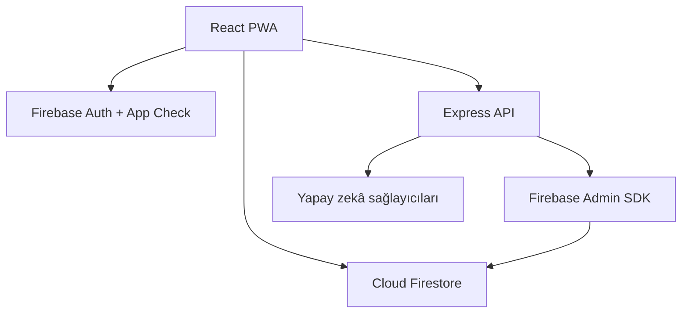

# ZekaPark

ZekaPark; BİLSEM hazırlığı için React, TypeScript, Express ve Firebase tabanlı,
mobil öncelikli bir öğrenme uygulamasıdır. Prosedürel görsel soru üretimi,
adaptif pratik, deneme sınavı, hata defteri, veli görünümü ve yönetim araçları
içerir.

> **Yayın durumu:** Kod tabanı ticari yayın için sertleştirilmiştir; ancak
> [ticari hazırlık kapıları](docs/COMMERCIAL_READINESS.md) tamamlanmadan gerçek
> öğrenci verisiyle üretime açılmamalıdır.

## Temel yetenekler

- Deterministik tohumla görsel ve mantıksal soru üretimi
- Yayın öncesi soru doğrulama, kalite puanı ve tekrar kontrolü
- Elo-benzeri beceri tahmini, zorluk seçimi ve aralıklı tekrar
- Kısıtlı geri bildirimli deneme sınavı akışı
- Öğrenci, veli ve özel claim korumalı yönetici rolleri
- Sunucu kontrollü aile hesabı oluşturma ve bağlı öğrenci hesabı
- Gerçek Firestore verisi kullanan yönetim özeti ve öğrenci görünümü
- PWA manifesti, güvenli çevrimdışı statik kabuk ve derin bağlantılar
- TypeScript, test, üretim derlemesi ve bağımlılık taraması içeren CI kapısı

## Mimari



Tarayıcı yalnızca Firestore kurallarının izin verdiği kullanıcı verisine erişir.
Aile kaydı, yönetim işlemleri, parola sıfırlama ve korumalı yapay zekâ uçları
Express API üzerinden yürür. Üretimde API, Firebase ID token ve App Check token
doğrulamasını birlikte uygular.

## Yerel geliştirme

Gereksinimler:

- Node.js 22+
- E-posta/şifre kimlik doğrulaması ve Cloud Firestore etkin bir Firebase projesi
- Sunucu özellikleri için Firebase Application Default Credentials

Kurulum:

```sh
cp .env.example .env.local
npm ci
npm run dev
```

`.env.local` içindeki istemci Firebase alanlarını doldurun. Yerel API'de App
Check'i geçici olarak kapatmanız gerekiyorsa yalnızca yerel ortamda
`ENFORCE_APP_CHECK=false` kullanın. Üretim başlatıcısı bu değeri reddeder.

## Kalite kapısı

Her pull request ve `main` güncellemesinde aşağıdaki kapı çalışır:

```sh
npm run check
npm audit --omit=dev --audit-level=high
npm run security:audit
```

`npm run check`; TypeScript doğrulaması, birim/regresyon testleri, 26.400
soruluk jeneratör matrisi ve istemci/sunucu üretim derlemelerini kapsar.

## Yetkilendirme modeli

- Tarayıcı kendi hesabı için yalnızca `student` veya `parent` profili
  oluşturabilir; yönetici profili üretemez.
- Yönetici erişimi hem Firestore profil rolünü hem de güvenilir sunucudan
  verilmiş Firebase `role=admin` özel claim'ini gerektirir.
- Sabit e-posta, sabit parola, anonim giriş veya yerel oturum yönetici yetkisi
  vermez.
- Yayınlanmamış soruları yalnızca yönetici okuyabilir; öğrenciler yalnızca
  `status == published` sorgusuyla yayınlanmış sorulara erişir.
- Veli yalnızca kendisine bağlı öğrencinin profilini ve özel ilerleme durumunu
  okuyabilir.
- Sunucu, ID token'ları iptal kontrolüyle doğrular; üretimde App Check zorunludur.

İlk yönetici, ayrıcalıklı ve denetlenen bir ortamda Firebase Admin SDK ile UID
üzerinden özel claim almalıdır. Yönetici yetkisi e-posta adresinden türetilmez.
Yetki kaldırıldığında yenileme token'larını da iptal edin.

## Üretim dağıtımı

Önerilen düzen, statik istemciyi Firebase Hosting'de ve API'yi Cloud Run'da aynı
origin altındaki `/api/**` yeniden yazımıyla sunmaktır.

```sh
npm run check
gcloud run deploy zekapark-api --source . --region europe-west1 --allow-unauthenticated
firebase deploy --only firestore:rules,hosting
```

Cloud Run servisi ağ düzeyinde erişilebilir olabilir; korumalı uçlar uygulama
düzeyinde Firebase ID token, App Check, rol denetimi ve hız sınırlaması uygular.

Üretimde en az şu sunucu değişkenleri gereklidir:

- `FIREBASE_PROJECT_ID`
- `FIREBASE_DATABASE_ID`
- `APP_BASE_URL` (HTTPS)
- `CORS_ALLOWED_ORIGINS` (yalnızca kesin HTTPS origin'leri)
- `ENFORCE_APP_CHECK=true`

İstemci ve API farklı origin'lerdeyse derleme sırasında `VITE_API_BASE_URL`
ayarlanmalıdır. Yalnızca statik Vercel dağıtımı `/api` işlevlerini sağlamaz;
ayrı API origin'i zorunludur.

Dağıtımdan önce App Check reCAPTCHA Enterprise anahtarını,
`VITE_FIREBASE_APPCHECK_SITE_KEY` ile istemciye verin. Sunucu sırlarını hiçbir
zaman `VITE_` önekiyle tanımlamayın; Secret Manager kullanın.

## Güvenlik ve yayın

- Güvenlik bildirimi ve olay adımları: [SECURITY.md](SECURITY.md)
- Ticari hazırlık skoru ve yayın kapıları:
  [docs/COMMERCIAL_READINESS.md](docs/COMMERCIAL_READINESS.md)

ZekaPark, MEB'in resmî uygulaması değildir; mağaza metinleri ve yasal belgeler
bu bağımsızlığı açıkça belirtmelidir.
